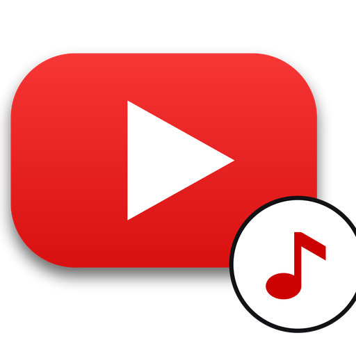
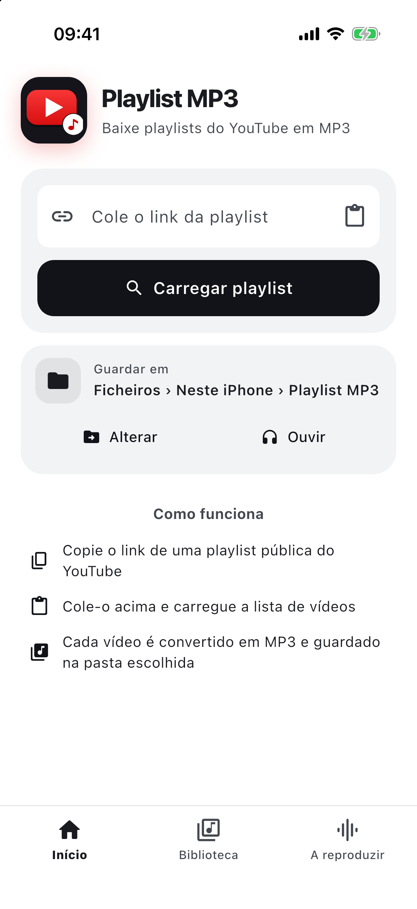
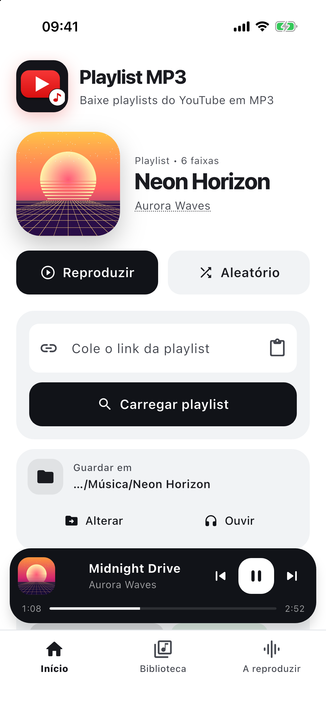
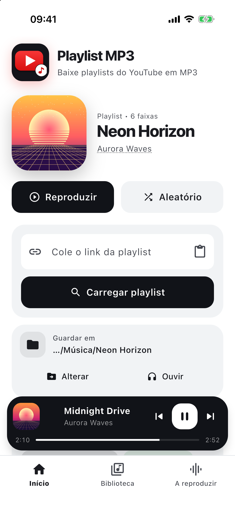
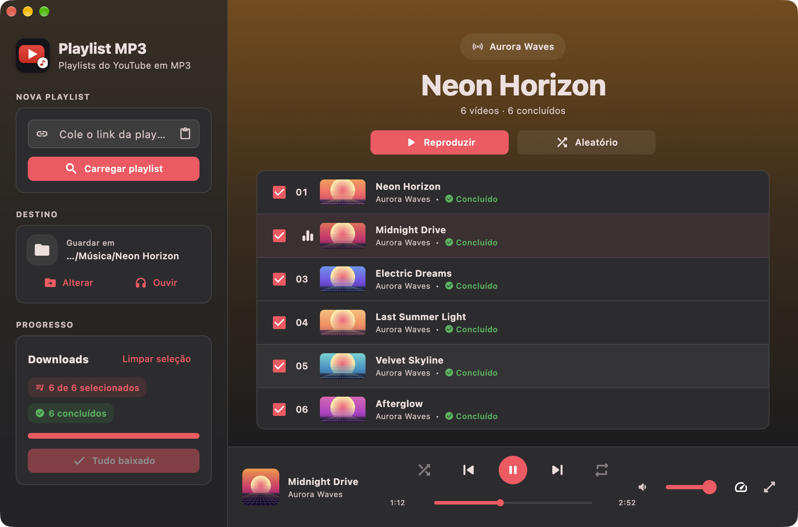
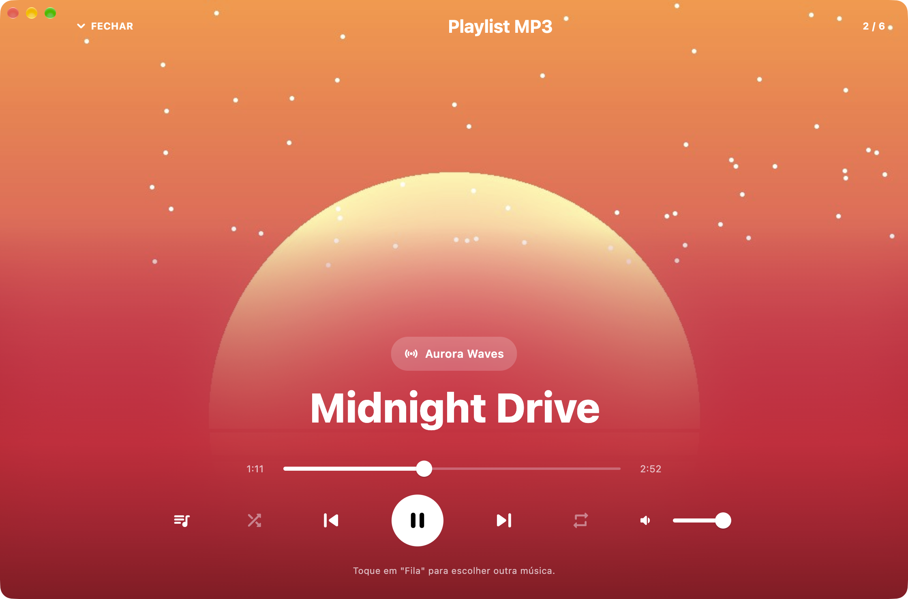

<div align="center">



# Playlist MP3

**Cole o link de uma playlist do YouTube e leve as músicas contigo em MP3, com capa e metadados.**
Inclui um reprodutor próprio, com um layout pensado para o telemóvel e outro para o computador.


</div>

---

## O que é

O **Playlist MP3** é uma aplicação Flutter multiplataforma que lê uma playlist pública (ou não listada) do YouTube, descarrega o áudio de cada vídeo, converte-o para **MP3** e guarda os ficheiros numa pasta com o nome da playlist. Cada ficheiro leva o título, o artista, o álbum e a capa embutidos, por isso aparece bem organizado em qualquer leitor de música.

A aplicação traz ainda um **reprodutor integrado**, para ouvir o que acabou de baixar sem sair da app.

## Capturas de ecrã

| Mobile: início | Mobile: playlist | Mobile: a reproduzir |
| :---: | :---: | :---: |
|  |  |  |

| Desktop: biblioteca | Desktop: reprodutor imersivo |
| :---: | :---: |
|  |  |

> Como gerar estas imagens: veja [`docs/screenshots/README.md`](docs/screenshots/README.md).

## Funcionalidades

### Download e conversão
- **Carregamento automático:** basta colar o link; a lista de vídeos aparece sozinha.
- Aceita **playlists públicas e não listadas**, links com `?list=...`, o ID direto da playlist e **Mixes** (`RD...`).
- **Seleção de faixas:** escolha tudo ou só as músicas que quer.
- Descarrega o **melhor áudio disponível** e converte-o para **MP3 a 192 kbps** com FFmpeg.
- **Metadados ID3** (título, artista, álbum) e **capa embutida** em cada ficheiro.
- **Progresso por faixa**, botão **Parar** e **Continuar** para retomar o que falhou ou ficou por fazer.
- Ficheiros numerados pela ordem da playlist (`01 - Título.mp3`).
- **Notificação** com o progresso do download e ação para parar.

### Reprodutor integrado
- Reproduz as músicas baixadas, ou qualquer pasta com MP3 (botão **Ouvir**).
- **Crossfade** de 6 segundos entre faixas.
- **Aleatório**, **repetição** (nenhuma, tudo, uma), **velocidade** (0,75× a 2×), **volume** e **fila**.
- Barra de progresso em forma de **onda de áudio** (mobile) e capa que se esbate na cor da imagem (desktop).
- **Controlos do sistema:** notificação, ecrã de bloqueio, Control Center e teclas multimédia, com **tempo decorrido e duração**.

### Dois layouts
O layout muda pela **largura da janela** (900 px), não só pelo sistema operativo.

| | Mobile (< 900 px) | Desktop (≥ 900 px) |
| --- | --- | --- |
| Estilo | Claro e minimalista, preto e branco | Barra lateral translúcida, degradê quente |
| Navegação | Barra inferior (Início, Biblioteca, A reproduzir) | Barra lateral + lista de faixas |
| Mini-player | Cartão escuro e arredondado | Barra de reprodução em três zonas |
| Reprodutor | «A reproduzir» com onda de áudio | Imersivo, com título grande e pílula do artista |

No desktop, o tema ainda se adapta ao sistema: **macOS** (estilo Apple), **Windows** (Fluent) e **Linux** (Yaru). O modo claro/escuro segue o sistema.

## Onde ficam os ficheiros

| Plataforma | Destino |
| --- | --- |
| Android | `Música/<nome da playlist>/` (via MediaStore, sem pedir permissões de armazenamento) |
| iOS | App **Ficheiros** › Neste iPhone › Playlist MP3 |
| macOS, Windows, Linux | Pasta à sua escolha (por defeito, **Transferências**), lembrada entre sessões |

## Como rodar

### Requisitos
- [Flutter](https://docs.flutter.dev/get-started/install) estável (3.44 ou superior, Dart `^3.12.2`).
- Ligação à internet.
- Para cada plataforma, a toolchain habitual do Flutter: Android Studio, Xcode, Visual Studio (Windows) ou os pacotes de compilação do Linux.

Confirme que está tudo pronto com:

```bash
flutter doctor
```

### Instalação

```bash
git clone https://github.com/DVS2000/youtube_playlist_mp3.git
cd youtube_playlist_mp3
flutter pub get
```

### Executar

```bash
flutter devices          # ver os dispositivos disponíveis

flutter run -d macos     # macOS
flutter run -d windows   # Windows
flutter run -d linux     # Linux
flutter run              # telemóvel ligado ou emulador (Android / iOS)
```

**Linux:** o reprodutor usa o `libmpv`. Instale-o antes de compilar:

```bash
sudo apt install libmpv-dev mpv
```

**iOS:** abra `ios/Runner.xcworkspace` no Xcode uma vez para definir a sua equipa de assinatura.

### Build de release

```bash
flutter build apk --release          # Android
flutter build ios --release          # iOS
flutter build macos --release        # macOS
flutter build windows --release      # Windows
flutter build linux --release        # Linux
```

> O `applicationId` do Android ainda é `com.example.youtube_playlist_mp3`. Troque-o pelo seu próprio ID antes de publicar numa loja.

### Testes e análise

```bash
flutter analyze
flutter test
```

Os testes de integração (`integration_test/`) precisam de um dispositivo ou emulador.

## Como funciona

1. **Ler a playlist.** `PlaylistFetcher` lê a página da playlist no YouTube e, se o formato mudar, recorre à API interna de navegação; segue a paginação até ao fim.
2. **Encontrar o áudio.** `AudioResolver` pede ao YouTube o stream de áudio de maior qualidade de cada vídeo.
3. **Descarregar.** `PlaylistDownloader` descarrega por blocos, com progresso e suporte a cancelamento.
4. **Converter.** O FFmpeg (`ffmpeg_kit_flutter_new_audio`) cria o MP3 a 192 kbps, com a capa e os metadados.
5. **Guardar.** `Mp3Saver` coloca o ficheiro no destino certo de cada plataforma.
6. **Reproduzir.** `PlaylistAudioHandler` (`just_audio` + `audio_service`) cuida da fila, do crossfade e dos controlos do sistema.

### Estrutura

```text
lib/
├── main.dart                  # arranque, janela desktop e tema
├── services/
│   ├── playlist_fetcher.dart  # lê playlists e Mixes do YouTube
│   ├── audio_resolver.dart    # obtém o stream de áudio
│   ├── audio_http_download.dart  # download por blocos
│   ├── playlist_downloader.dart  # download + conversão FFmpeg
│   ├── mp3_saver.dart         # guarda no destino de cada plataforma
│   ├── audio_library.dart     # reconstrói a fila a partir de uma pasta
│   ├── player_service.dart    # reprodutor, crossfade, controlos do sistema
│   └── notification_service.dart
└── ui/
    ├── theme.dart             # tokens de design por plataforma
    ├── home_page.dart         # layouts mobile e desktop
    ├── widgets.dart           # cartões, botões, linhas de faixa
    ├── player_bar.dart        # mini-player (mobile) e barra (desktop)
    └── full_player.dart       # «A reproduzir» e reprodutor imersivo
```

### Principais dependências

`just_audio` · `just_audio_media_kit` · `audio_service` · `ffmpeg_kit_flutter_new_audio` · `window_manager` · `file_picker` · `flutter_local_notifications` · `shared_preferences` · `path_provider`

## Limitações

- Só funciona com playlists **públicas ou não listadas**. Playlists privadas não são lidas.
- A aplicação usa endpoints não documentados do YouTube. Se o YouTube alterar o seu funcionamento, os downloads podem falhar até a app ser atualizada.
- Vídeos com restrição de idade, região ou conta podem ficar indisponíveis.
- Testada em **macOS, iOS e Android**. Os temas de Windows e Linux existem no código, mas ainda não foram testados.

## Aviso legal

Este projeto é **educativo e de uso pessoal**. Descarregar conteúdo do YouTube pode violar os [Termos de Serviço](https://www.youtube.com/t/terms) da plataforma e as leis de direitos de autor do seu país. Use-o apenas com conteúdo que lhe pertença, que esteja em domínio público ou que tenha licença que o permita. O autor não se responsabiliza pelo uso que for dado à aplicação. Não é afiliado nem endossado pelo YouTube ou pela Google.

## Contribuir

Sugestões e correções são bem-vindas. Abra uma *issue* para discutir a mudança e, antes de enviar um *pull request*, corra `dart format .`, `flutter analyze` e `flutter test`.
